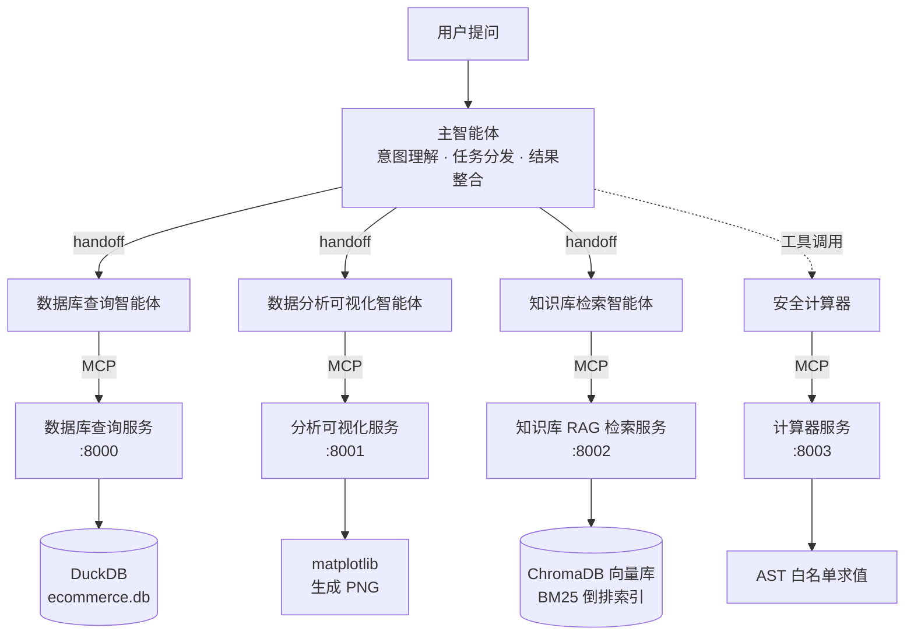
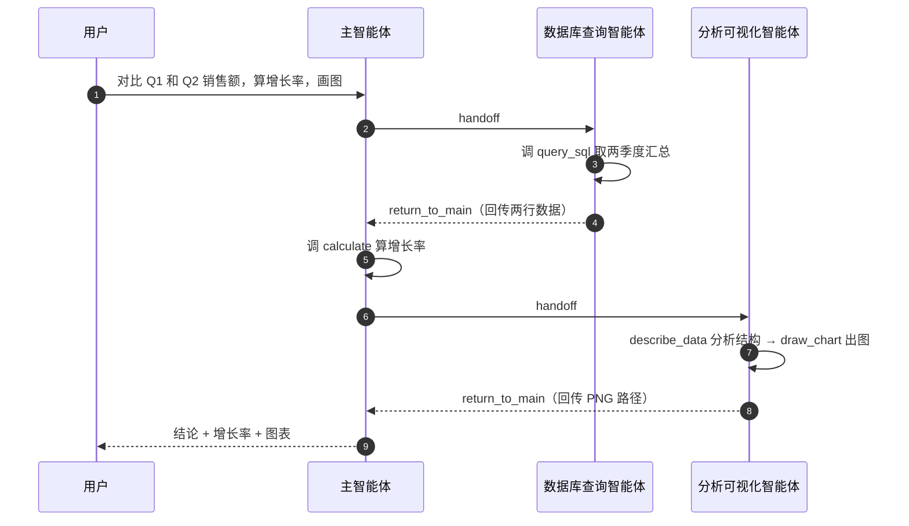
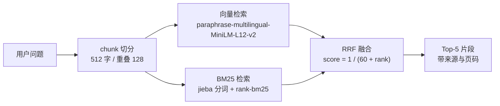

# 多智能体数据分析系统

<p align="center">
  <b>用自然语言问数据 · 让 AI 帮你分析</b>
  <br>
  <i>OpenAI Agents SDK · DeepSeek · 多智能体编排 · 自动可视化 · RAG 知识库</i>
</p>

<p align="center">
  
  
  
  
  
  
</p>

<p align="center">
  
</p>

---

## 痛点 & 解决方案

| 痛点 | 解决方案 |
|------|---------|
| 分析数据要写 SQL，业务人员不会 | 中文提问，AI 自动理解意图并生成查询 |
| 查完数据还要复制到 Excel 画图 | 一句话同时完成查询、计算、图表生成 |
| 行业报告分散在 PDF/文档里，没法联动查询 | RAG 知识库自动索引，直接提问即可检索 |
| 多个分析步骤要手动衔接（查 A → 算 B → 画 C） | 多智能体自动编排，handoff 机制串联任务 |

**一句话：输入中文问题，系统自动查数据库、算指标、画图表、搜知识库，一步到位。**

---

## 快速开始

```bash
# 1. 安装依赖
python -m venv venv
.\venv\Scripts\activate      # Windows
pip install -r requirements.txt

# 2. 配置 API Key
cp .env.example .env
# 编辑 .env，填入 DEEPSEEK_API_KEY

# 3. 一键启动
python run.py
```

浏览器打开 `http://localhost:8501`，点击侧边栏 **「初始化系统」**，开始提问。

---

## 使用方式

### Web 界面（推荐）

```bash
python run.py
```

<p align="center">
  
</p>

主聊天页之外还有两个管理页面：

| 页面 | 能力 |
|------|------|
| 📚 知识库 | 上传并索引 PDF/DOCX/XLSX/TXT/MD/CSV、查看已索引文档、删除文档、重建全部索引 |
| 🗄️ 数据库 | 上传 `.db` / `.duckdb` / `.sqlite` 文件，查看内置与用户数据库 |

### CLI 交互模式

```bash
python run.py --cli
```

<p align="center">
  
</p>

### 典型问题

```
各品类销售额排行
每月销售趋势如何
用户等级分布情况
各城市销售额 TOP10
对比 Q1 和 Q2 的销售数据，算增长率，画图
```

---

## 系统架构

分层设计：**4 个智能体** 负责「理解与决策」，**4 个 MCP 服务** 负责「干活」。两者之间只通过 MCP 协议通信，服务可独立启动、独立测试、独立替换。



**为什么这么切：** 智能体只持有「该不该做、谁来做」的判断逻辑，具体实现全部下沉到 MCP 服务。新增一个数据源 = 新起一个 MCP 服务 + 给对应智能体挂一个连接，主智能体的编排逻辑不用改。同样的四个服务，换成别的框架（LangGraph、自研调度）也能直接复用。

### 一次多步任务的完整链路

以「对比 Q1 和 Q2 的销售数据，算增长率，画图」为例，两个子智能体接力完成，每次都由主智能体重新分发：



子智能体完成后通过 `return_to_main` 交回控制权，**不直接面向用户**——保证多步任务的上下文始终由主智能体统一收敛。

---

## 智能体

| 智能体 | 职责 | 挂载能力 |
|--------|------|---------|
| **主智能体** | 理解意图、分发任务、整合回复 | 计算器 + 3 个 handoff |
| **数据库查询智能体** | 查 Schema、写 SQL、返回 Markdown 表格 | 数据库服务、计算器 |
| **数据分析可视化智能体** | 从对话历史取数、描述数据、生成图表 | 可视化服务、计算器 |
| **知识库检索智能体** | 知识库混合检索、联网搜索 | RAG 服务、计算器 |

所有智能体统一使用 `deepseek-v4-flash`（`agent_system/config.py`）。Web 界面侧边栏可在 `deepseek-v4-flash` / `deepseek-chat` / `deepseek-reasoner` 之间切换。

---

## MCP 服务

全部以 **Streamable HTTP** 方式运行在 `127.0.0.1`，按需请求，无长连接。注册表在 `run.py` 的 `SERVERS` 列表。

### 数据库查询服务（:8000）
DuckDB 嵌入式数据库，只读 SQL 查询。

| 工具 | 用途 |
|------|------|
| `query_sql` | 执行 SELECT 查询（DDL/DML 自动拦截） |
| `get_tables` / `get_schema` / `get_schema_markdown` | 查看表结构与元数据 |
| `get_sample_data` / `get_table_stats` | 抽样预览、行数与分布统计 |

### 分析可视化服务（:8001）
matplotlib 渲染，支持柱状 / 堆叠柱状 / 横向条形 / 折线 / 面积 / 散点 / 饼图 7 种图表。

| 工具 | 用途 |
|------|------|
| `describe_data` | 数据质量分析、统计摘要（列类型、缺失值、异常值） |
| `draw_chart` / `visualize_data` | 指定类型出图 / 自动选型出图 |
| `get_chart_types` / `health_check` | 查询可用图表类型、健康检查 |

### 知识库 RAG 检索服务（:8002）
ChromaDB 向量检索 + BM25 关键词检索，RRF 融合排序。

| 工具 | 用途 |
|------|------|
| `search_knowledge` | 混合检索（语义 + 关键词） |
| `upload_document` / `delete_document` | 上传（PDF/DOCX/XLSX/TXT/MD/CSV）与删除 |
| `list_documents` / `get_document_info` / `reindex_all` | 文档管理、索引状态、重建索引 |
| `web_search` | 联网搜索（Tavily） |

### 计算器服务（:8003）
基于 `ast.NodeVisitor` 的白名单求值，只放行白名单函数与常量，其余语法直接抛异常，杜绝 `eval` 注入。

| 工具 | 用途 |
|------|------|
| `calculate` | 四则运算、百分比、幂、开方、常用数学函数 |

### RAG 混合检索链路



两路各取候选 50 条，RRF（K=60）按排名而非分数融合，规避向量距离与 BM25 分数不可比的问题，也不需要调权重参数。

---

## 数据库

内置 DuckDB 电商数据库 `ecommerce.db`（约 4 MB）：

| 表 | 行数 | 说明 |
|----|------|------|
| `orders` | 322 | 订单：金额、时间、城市、支付方式 |
| `inventory` | 986 | 库存：数量、变动日期 |
| `reviews` | 173 | 评价：评分、内容 |
| `products` | 58 | 商品：名称、价格、品类 |
| `users` | 50 | 用户：等级、注册日期 |
| `categories` | 10 | 品类：名称 |

---

## 实测结果

数据来自 [`reports/评估报告_多智能体数据分析系统.md`](reports/评估报告_多智能体数据分析系统.md)（37 个用例）：

| 维度 | 结果 |
|------|------|
| 功能场景（查询 / 查询+画图 / 多步链路 / RAG / 计算 / 异常输入） | 6/6 通过 |
| 用例总通过率 | 97%（36/37） |
| 多轮对话上下文 | 18/18 |
| 稳定性检查项 | 12/13 |
| 工具路由准确率 | ~95% |
| 图表生成 | 26 张，100% 成功 |

**已知限制（报告中原样记录，未做粉饰）：** 计算器连续调用 10 次以上会明显变慢；单次输入超过 500 字时 30 秒超时；长链路偶发 OpenAI Agents SDK 的 cancel-scope 报错。

<p align="center">
     
</p>

---

## 技术栈

| 层面 | 选型 | 原因 |
|------|------|------|
| **LLM** | `deepseek-v4-flash` | 高性价比中文推理 |
| **智能体框架** | OpenAI Agents SDK | 原生 handoff 编排、MCP 集成 |
| **通信协议** | MCP Streamable HTTP | 按需请求，无需长连接 |
| **数据库** | DuckDB | 嵌入式列式存储，免安装 |
| **可视化** | matplotlib | 服务端直接渲染 PNG，无需前端渲染依赖 |
| **向量检索** | ChromaDB + sentence-transformers | 本地持久化，免云服务 |
| **关键词检索** | jieba + rank-bm25 | 中文分词 BM25 |
| **融合排序** | RRF（K=60） | 无参数调优的混合排序 |
| **文档解析** | pdfplumber / python-docx / openpyxl | 多格式支持 |
| **前端** | Streamlit | 快速搭建数据应用 |

---

## 项目结构

```
├── agent_system/          # 智能体编排（11 模块）
│   ├── agents.py          #   4 个智能体定义 + handoff 关系
│   ├── config.py          #   模型与 MCP 地址配置
│   ├── cli.py             #   命令行交互入口
│   └── ...                #   对话历史、工具路由、进度回调、handoff 过滤
├── app/                   # Streamlit 前端（6 模块）
├── pages/                 # 知识库 & 数据库管理页面
├── mcp_servers/           # MCP 服务器集群
│   ├── common/            #   公共组件（日志、限流）
│   ├── db_server/         #   数据库查询服务 :8000
│   ├── analysis_server/   #   分析可视化服务 :8001
│   ├── rag_server/        #   知识库 RAG 检索服务 :8002
│   └── calculator_server/ #   安全计算器服务 :8003
├── knowledge_base/        # 知识库文档
├── vector_db/             # ChromaDB 持久化目录
├── tests/                 # 测试用例（9 个文件：单元 / 集成 / 边界 / 路由 / 稳定性）
├── assets/                # 项目截图与示例图表
│
├── run.py                 # 统一启动脚本
├── ecommerce.db           # 电商数据
├── requirements.txt
├── Dockerfile / docker-compose.yml
└── .env.example
```

---

## Docker 部署

```bash
cp .env.example .env
docker compose up -d
# 访问 http://localhost:8501
```

容器内由 entrypoint 先拉起 4 个 MCP 服务，轮询 8000–8003 就绪后再前台启动 Streamlit，退出时自动回收子进程。8000–8003 只在容器内通信，对外仅暴露 8501。

持久化 volume：向量索引（`vector_db`）、知识库文档（`knowledge_base/raw`）、生成的图表（`reports/charts`），重启不丢失。

---

## 命令速查

| 命令 | 作用 |
|------|------|
| `python run.py` | 启动服务 + Web 界面 |
| `python run.py --cli` | 启动服务 + CLI 模式 |
| `python run.py --server` | 仅启动 MCP 服务 |
| `python run.py --stop` | 停止所有服务 |

---

## 环境变量

| 变量 | 说明 |
|------|------|
| `DEEPSEEK_API_KEY` | **必需**，[申请地址](https://platform.deepseek.com/api_keys) |
| `TAVILY_API_KEY` | 可选，联网搜索能力，缺失时 `web_search` 不可用 |
| `SUPABASE_URL` / `SUPABASE_KEY` | 可选，云向量后端（pgvector）同步，缺失时仅用本地 ChromaDB |
| `JWT_SECRET` / `ADMIN_PASSWORD` | 预留项，当前代码未读取 |

---

## 前置条件

- **Python 3.11+**
- **DeepSeek API Key** — [申请](https://platform.deepseek.com/api_keys)
- **（可选）Tavily API Key** — 联网搜索，[注册](https://tavily.com)

---

<p align="center">
  <sub>MIT License · 基于 OpenAI Agents SDK + DeepSeek 构建</sub>
</p>
